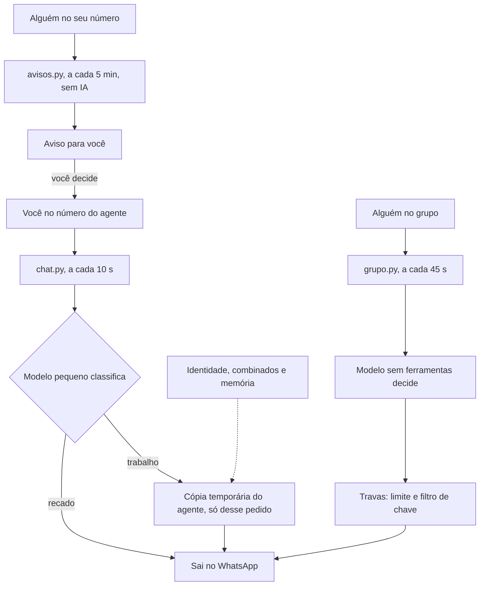

# sheep-zap

Skill que faz o seu agente atender o WhatsApp do jeito que a Sheep atende: você manda um pedido no número dele, ele faz e responde. Criada por Marcus Forti, a partir do sistema que roda de verdade com a Sheep.

## Instalar

**Windows (PowerShell):**

```powershell
irm https://raw.githubusercontent.com/marcusforti/sheep-zap/main/instalar.ps1 | iex
```

**Mac ou Linux:**

```bash
curl -fsSL https://raw.githubusercontent.com/marcusforti/sheep-zap/main/instalar.sh | bash
```

Depois abra o Claude Code e escreva `/sheep-zap`. Ele guia a instalação, uma etapa por vez.

**Quer ver antes de instalar?** A página mostra o caminho de uma mensagem e o grafo com todas as peças: https://marcusforti.github.io/sheep-zap/

## O que precisa

- Claude Code com login feito. Esta versão ainda não funciona só com o Codex.
- Python 3.9 ou mais novo.
- [Evolution no ar](https://github.com/marcusforti/sheep/blob/main/servidor/README.md).
- Um número de WhatsApp só para o agente.
- Opcional: seu número conectado também, para ele responder como você.
- Opcional: ElevenLabs, para áudio.

Quem usa o painel da Sheep não precisa cadastrar as chaves de novo: as de Conexões já valem.

## Como funciona



- **O agente é um só para você.** Cada pedido de trabalho abre uma cópia temporária, com a mesma identidade e as mesmas regras, que faz aquilo, responde e é encerrada. No máximo 2 ao mesmo tempo.
- **Não fica mudo.** Avisa que pegou, conta o que está rodando com `status`, para o que passar do tempo e insiste na entrega se a internet cair.
- **A sua frase escolhe quem fala.** "responde lá" é áudio do agente, "responde a msg" é texto do agente, "responde pra mim" é áudio na sua voz, "responde a msg pra mim" é texto como você.
- **Quem responde grupo não tem ferramenta nem memória.** Mesmo enganado, não abre arquivo nem roda nada, e um filtro fora da IA segura texto com cara de chave.
- **Só diz "entregue" com prova do WhatsApp.** "Aceito" não basta. Vale para o que ele manda a outras pessoas.
- **Quem lembra é a pasta.** Cada cópia nasce lendo os seus combinados. Quando você corrigir o agente, a correção vira uma linha nesses arquivos.

## Cuidados

- **O computador precisa ficar ligado.** A Evolution fica no servidor, mas quem pensa roda aqui.
- **As cópias têm acesso ao seu computador.** Só o seu chat aciona elas. Mensagem de outras pessoas é tratada como dado, não como ordem, mas nenhuma regra de IA é garantia absoluta: não deixe o agente numa máquina com o que você não aceitaria arriscar.
- **Use https na Evolution para uso sério.** O guia da Oracle sobe em `http`, sem cadeado: a chave e as conversas passam abertas, e alguém numa rede hostil poderia ler ou falsificar mensagens. O `confere.py` avisa.
- **Mensagem em massa bloqueia número.** A Evolution não é o canal oficial do WhatsApp. O envio sai com intervalo, e o agente só escreve para terceiros quando você pede.
- **Dados de terceiros.** As conversas ficam no seu computador e passam pelo seu Claude quando você pede uma resposta. Trate com cuidado, e use voz de outra pessoa só com autorização dela.

## O que tem aqui

| Pasta | O que é |
|---|---|
| `skill/sheep-zap/` | A skill que vai para o seu computador |
| `skill/sheep-zap/scripts/` | Os serviços. Só biblioteca padrão do Python |
| `skill/sheep-zap/modelos/` | Prompts que viram os seus na instalação |
| `skill/sheep-zap/references/` | Instalação guiada, operação e problemas |
| `docs/` | A página, com o fluxo e o grafo da skill |
| `tests/` | Testes com uma Evolution e um Claude de mentira. Rode com `python -m unittest discover -s tests` |
